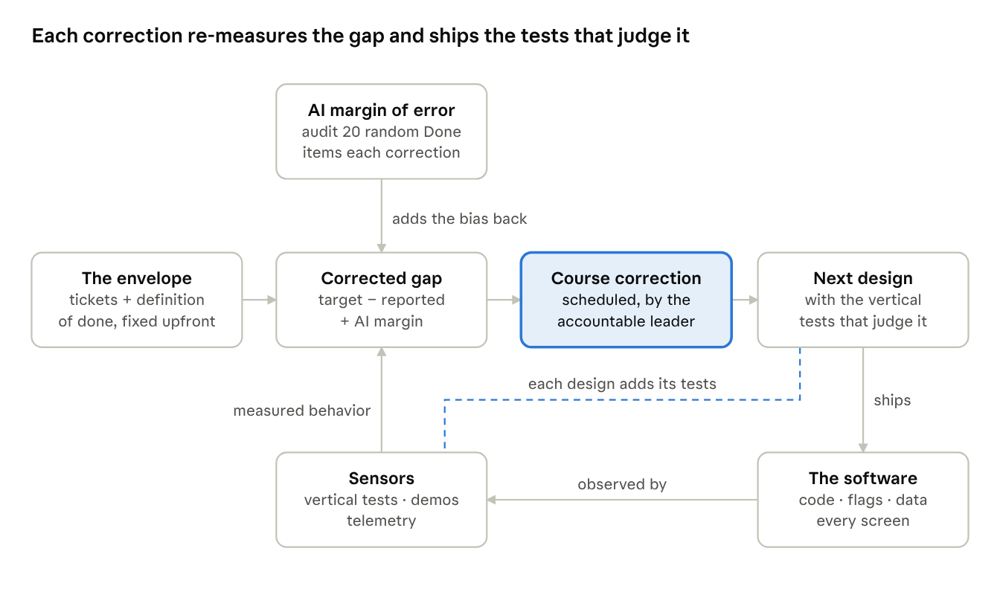

# Closing the Loop on AI-Assisted Delivery

*Why your tickets say done when the software isn't, and a control-loop fix.*

## The premise

**Run every delivery program as a closed control loop.** Fix an envelope: the full set of tickets slated for delivery, each tied to a written definition of done. Measure the real state of the software against it on a fixed rhythm, and name and measure the error that AI tools and haste add to reported progress. At scheduled points, correct course by publishing a new design together with the tests that will prove it.

Quality does not come from getting it right the first time. It comes from shrinking a measured gap at every pass.

## AI made us faster. It also made our dashboards lie.

With AI IDEs like Cursor, my teams merge more code per week than ever. Tickets close, demos go green, and the burndown looks healthy. Yet the platform is not proportionally closer to done.

The tools are not the problem. They raise output faster than they raise evidence. On one migration I mapped, about 280 tickets were tracked and 63% were closed. None of the 46 packages that actually defined delivery had started.

That gap between reported progress and real progress is what this article is about, and how to close it.

## Why the usual signals fail

Every common progress signal can read "done" while the software is not:

- **Ticket closure** measures paperwork, not behavior. A closed ticket says someone stopped working on it.
- **Merged is not live.** Code behind a switched-off feature flag passes every check and changes nothing for a customer.
- **One green screen.** A fix makes one report correct while another screen showing the same number still disagrees.
- **The false oracle.** "Make it match that screen" is a prompt AI handles very well. If that screen is wrong, you now have two wrong screens that agree.
- **Self-graded tests.** When the same hand, human or AI, writes both the code and its test, they agree by construction.

These errors are not random. They all lean the same way: toward looking finished. A bias with a direction is something you can measure and correct, but only if your process admits it exists.

## The envelope: run delivery as a closed loop

Control engineers face this problem daily. When a system has bias, they do not hope the error goes away. They measure the output, compute the error against a target, adjust, and measure again.

Software delivery maps onto that loop almost one to one:

| Control idea | In software delivery |
| --- | --- |
| Setpoint | The envelope: every ticket slated for delivery, each package with a written definition of done |
| Plant | Code, feature flags, data, and every screen that shows the result |
| Sensors | Evidence of behavior: end-to-end tests, parity checks, demos marked pass or fail, flag telemetry |
| Error | The gap between the envelope and what the sensors measure |
| Controller | The accountable technical leader, making course corrections |
| Actuator | The next packages, gates, rollbacks, staffing, retooling, or a new design |

The envelope is fixed in advance, and that matters. You cannot declare victory on whatever happened to finish. Progress is always measured against the same, written target.

The top row decides and acts; the bottom row measures. The dashed path is what makes the loop learn: each new design adds the tests that will judge it.

## Name the AI margin of error, then measure it

Because the bias has a direction, give it a name: the AI margin of error. The gap you steer on is not target minus reported progress. It is:

**corrected gap = target − reported progress + AI margin of error**

The margin is not a guess. At each correction point, pick about 20 tickets marked Done at random, not chosen by the people who closed them. Run each against an end-to-end test. The share that fails is your measured margin.

Two details keep it honest:

- **Not measured is its own number.** A Done ticket with no test that covers it is reported separately, never as a pass. A high count is a coverage gap, not a clean result.
- **Read trends, not small differences.** With 20 samples the figure is coarse. Compare its direction across correction points.

This is not an argument against AI. AI is a powerful actuator. Its error simply has to be in the equation.

## The error model behind it

The AI margin of error rests on established statistics. Three parts are core and cost almost nothing. Two are extensions for larger programs.

### 1. The margin is a proportion, so report its range

If 6 of 20 audited Done items fail, the estimate is 30%. With only 20 samples, the true rate could plausibly be anywhere from about 15% to 52% (a 95% Wilson interval). Report both numbers.

This tells you how to read change. A move from 30% to 25% between correction points is noise. A move from 30% to 10% is signal.

### 2. Size the audit with acceptance sampling

Quality engineering already answers "how many do we check?" through [acceptance sampling](https://cqeacademy.com/cqe-body-of-knowledge/product-process-control/acceptance-sampling/). A plan is a sample size and an acceptance number, chosen against two named risks: rejecting good work (commonly 5%) and accepting bad work (commonly 10%).

| Audit result | What it actually proves |
| --- | --- |
| 0 failures in 20 | True failure rate below about 11%, with 90% confidence |
| 0 failures in 20 | Below about 14%, with 95% confidence |
| 0 failures in 60 | Below about 5%, with 95% confidence |
| 6 failures in 20 | Anywhere from about 15% to 52% |

So a clean audit of 20 does not mean zero AI margin. Write your final acceptance tolerance in these terms: the worst margin you will accept, and how often you are willing to be wrong. If the tolerance is tight, the final audit needs a bigger sample.

### 3. A growing gap is negative reliability growth

[Reliability growth models](https://ifs.host.cs.st-andrews.ac.uk/Books/SE9/Web/DepSecAssur/GrowthModels.html) track how software improves as testing finds and fixes faults. Later models, such as Littlewood and Verrall's (1973), allow for fixes that introduce new faults, so reliability can get worse.

The compounding rule is that case. When the gap grows after a correction, the model says the process is wrong, not that you were unlucky. That is why the response is to change the controller rather than push harder.

### Extension A: combine the sensors with a Kalman filter

You have two imperfect readings of the same hidden quantity, true progress:

- **Weekly reported progress:** frequent, but biased upward.
- **The audit at each correction point:** rare, but unbiased, though noisy with small samples.

A Kalman filter keeps a running estimate of true progress and its uncertainty. Each week it predicts where progress should be, then corrects that guess with the new reading, weighting each reading by how far it can be trusted. Weekly readings move the estimate a little, after their known bias is removed. An audit moves it a lot, because it is unbiased.

The result is a true-progress estimate with error bars every week, not only on audit days. There is precedent: [Kim and Reinschmidt (2010)](https://pure.psu.edu/en/publications/probabilistic-forecasting-of-project-duration-using-kalman-filter/) combined a Kalman filter with earned value to forecast project duration probabilistically. It does need someone comfortable with the modelling, so it suits larger programs.

### Extension B: estimate what nobody found with capture-recapture

Ecologists count fish in a lake without draining it. They catch some, tag them, release them, then catch again. The share of tagged fish in the second catch reveals the total population. Software inspection research has used the same method since 1992 to estimate faults remaining after a review, as [Ahrefors, Thelin, Runeson and Wohlin (2004)](https://lup.lub.lu.se/search/publication/282e2518-f7d2-49e0-bd9c-49934bcf9849) review.

Applied here, the vertical tests and an independent reviewer check the same Done items separately. Suppose the tests flag 8 problems, the reviewer flags 6, and 4 are found by both. The estimated total is 8 × 6 ÷ 4 = 12, so about 2 problems were found by neither.

Low overlap between the two means many problems are still hidden. High overlap means your sensors are converging. The method only works if the two checks are truly independent, which is exactly what the "different hands" rule guarantees.

## Every correction ships with the tests that prove it

Unit tests cannot see the failures that matter most here. Each layer passes on its own, while two screens still show different totals. The sensor that catches this is a **vertical test**: one business journey through every layer, checking that every screen and report agrees.

The key move is that the test set changes with each correction. Every new design is published together with the vertical tests that will judge it, written before the code ships. Six rules keep that honest:

1. **Ratchet, don't replace.** Tests carry forward from one correction to the next. Retiring one needs a written reason.
2. **Report two numbers.** The pass rate on carried-forward tests shows regression; the pass rate on new tests shows progress. A new design cannot hide a regression.
3. **Expected values come from written policy,** never from what the system returns today.
4. **Different hands.** Whoever implements a change, human or AI, is never the only author of its expected values.
5. **Keep it small.** Three to eight vertical journeys per correction, covering only what the new design touches.
6. **Failures at baseline are the measurement, not the defect.** A known failing test is honest error. A false pass is the real problem.

## Two clocks, never confused

The loop runs on two time scales over the same software. Mixing them up is a common way programs drift.

| Clock | Cadence | Owner | What it does |
| --- | --- | --- | --- |
| Sensing | Weekly | Team leads | Demos marked pass or fail, plus a run of the vertical tests. Early warning, no redesign |
| Course correction | Monthly, on fixed dates | Accountable technical leader | Re-measure the corrected gap, make the calls, publish the next design and its tests |
| Acceptance | Once, at the end | Accountable technical leader | Run the frozen test set. Accept or reject against an agreed tolerance. No new design |

On the migration above, that meant three correction points a month apart, then final acceptance. Anything outside tolerance at the end becomes a deferred item with a written policy. Nothing quietly disappears from scope.

## When the gap grows, change the controller, not the gain

Sometimes a correction makes the measured gap bigger. The instinct is to push the same fix harder: another patch to the one screen, another retry, another hotfix. In control terms, that is turning up the gain on a loop whose model is wrong.

The rule is simple. If the gap grew after a correction, change the controller before shipping more of the same. That can mean a different policy, a different design pattern, better sensors, different staffing or a smaller scope. Then publish the revised design and its tests.

One exception does not wait for the next correction point. Irreversible actions, such as switching a production data path or migrating customer money, need interlocks that act continuously. A monthly review that finds an irreversible mistake is too late.

## What it looked like on a real migration

The context was a platform migration done strangler-style, with billing totals, policy status and generated documents shared across many screens. The team used AI IDEs heavily. At the baseline measurement:

- About 280 tickets were tracked and 63% were closed. On a dashboard, that reads as two-thirds done.
- All 46 packages that defined delivery were still unstarted.
- The new data layer was merged in several waves, all switched off. No data type had yet been cut over, soaked and rolled back.
- A critical bug showed customers a different total on two screens. That is exactly the multi-screen disagreement vertical tests are built to catch.

The loop reframed the program in its first weeks. Ticket closure became a footnote and per-area evidence became the measure. The first set of vertical tests was built before the first correction point, so it could serve as the baseline. Switching on the new data layer in production was gated behind a non-production pilot and a timed rollback drill.

Results from the correction points themselves will be the subject of a follow-up.

## How to start next week

1. **Fix the envelope.** List every ticket slated for delivery and give each package a one-line written definition of done.
2. **Choose your sensors.** Decide what counts as evidence for each area, and demote ticket closure to a footnote.
3. **Put the clock on the calendar.** Schedule three or four correction points and one acceptance date now, not later.
4. **Build the baseline tests first.** Three to eight vertical journeys, built and run before the first correction point.
5. **Audit the margin.** At each correction point, test 20 random Done tickets and publish the share that fails.
6. **Correct, don't just review.** At each point: measure, decide, and publish the next design together with its tests.
7. **Gate what can't be undone.** Production cutovers and money paths wait for their pilot and rollback drill.
8. **Watch for compounding.** If the gap grew, change the approach before shipping more of the same.

## The point

AI IDEs raise the rate of change. Quality depends on whether your evidence keeps up with it.

The loop does not ask you to be right the first time. It asks for an honest measure, a named bias, and the discipline to correct on schedule. Ship each design together with the test that will judge it, and the gap closes pass by pass.
